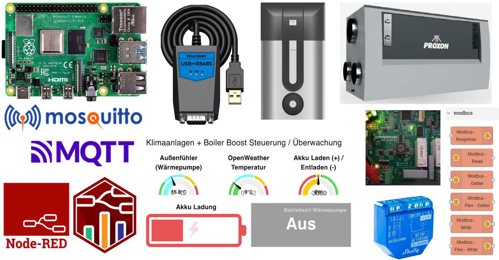
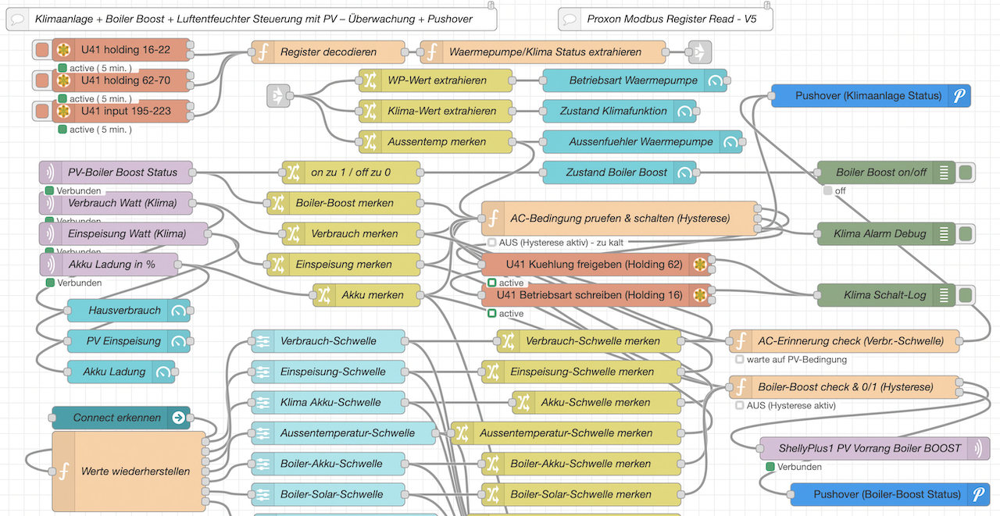
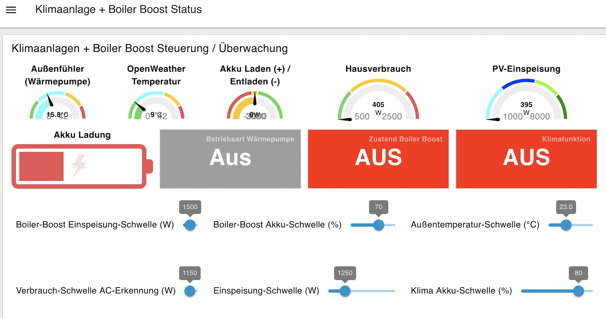
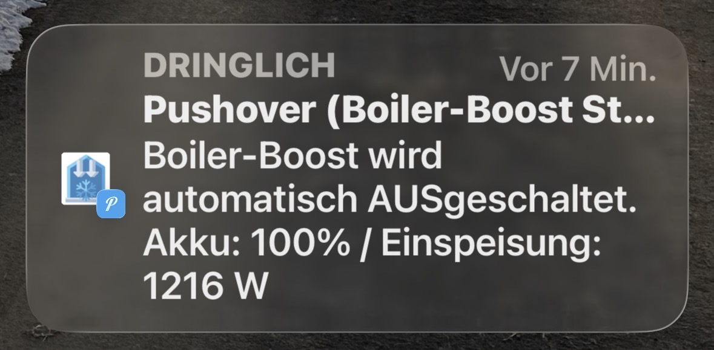

[](pictures/Edis-Blog-IoT-Logo.png)

# Proxon Klimaanlage & T300 Boiler Boost mit PV-Überschuss-Steuerung in Node-RED

[](https://www.gnu.org/licenses/gpl-3.0)
[](https://nodered.org/)
[](https://dashboard.flowfuse.com/)
[](https://flows.nodered.org/node/node-red-contrib-modbus)
[](https://mosquitto.org/)
[](https://www.shelly.com/)
[](https://pushover.net/)
[](https://claude.ai/)

[](pictures/2026-10-20-edi-teppert-com-Klimaanlage-BoilerBoost-PV-Titel.png)

## 🌍 Language Selector / Sprachauswahl

| Language   | Documentation                  |
| ---------- | ------------------------------ |
| 🇬🇧 English | [README.md](README.md)         |
| 🇩🇪 Deutsch | [README.de.md](README.de.md)   |

**Kostenlosen Solarstrom** zum Kühlen und für Warmwasser nutzen. Dieser Node-RED-Flow schaltet die **Kühlfunktion einer Proxon-Wärmepumpen-Lüftungsanlage** und den **Boiler Boost einer Proxon-T300-Warmwasser-Wärmepumpe** automatisch – aber nur, wenn die PV-Anlage genug Leistung liefert, der Hausakku ausreichend geladen ist und es (fürs Kühlen) draußen tatsächlich warm ist.

Die Werte kommen vom **E3/DC-Hauskraftwerk per MQTT** und direkt aus den **Proxon-Geräten per Modbus RTU (RS485)**. Jeder Schaltvorgang wird per **Pushover** gemeldet, und eine Seite im **Node-RED Dashboard 2.0** zeigt alle Werte an und erlaubt es, die Schwellwerte mit Reglern einzustellen.

> **Hinweis zu den Proxon-Geräten:** Die Modbus-Schnittstelle arbeitet mit **19200 Baud, 8 Datenbits, Parity *even*, 1 Stoppbit**. Mit Parity *none* bekommt man keine Antworten.

## Funktionen

- **PV-gesteuerte Kühlung (Klimafunktion)**
  - Schaltet nur ein, wenn *Außentemperatur* **>** Schwelle **UND** *Akku-SOC* **≥** Schwelle **UND** *PV-Leistung* **>** Schwelle.
  - Schreibt Betriebsart (Holding-Register 16) und Kühlungsfreigabe (Holding-Register 62) der Proxon-Anlage per Modbus.
  - Außentemperatur vom anlageneigenen **T3-Frischluftfühler** (Input-Register 198).
  - Solange noch kein Temperaturwert empfangen wurde, bleibt die Kühlung sicherheitshalber **aus**.
- **PV-gesteuerter Boiler Boost (T300)**
  - Schaltet einen **Shelly Plus 1** per MQTT, wenn *Akku-SOC* **≥** Schwelle **UND** *PV-Leistung* **≥** Schwelle – Warmwasser nur mit kostenlosem Strom.
- **„Klima läuft“-Erkennung mit Erinnerung**
  - Liegt der Hausverbrauch über einer einstellbaren Schwelle, gilt die Kühlung als laufend.
  - Läuft sie länger als **5 Min.**, obwohl die PV-Bedingung nicht erfüllt ist (z. B. von Hand eingeschaltet oder das automatische Ausschalten hat nicht geklappt), kommt alle **30 Min.** eine Pushover-Erinnerung.
  - Während der Mindestlaufzeit der Automatik wird nicht erinnert.
- **Hysterese / Kompressorschutz**
  - Kühlung: Mindestlaufzeit **15 Min.**, Mindestpause **10 Min.**
  - Boiler Boost: Mindestlaufzeit **10 Min.**, Mindestpause **10 Min.**
- **Pushover-Benachrichtigung** bei jedem automatischen Ein- und Ausschalten, inklusive aktueller Werte und Schwellen.
- **Node-RED Dashboard 2.0**
  - Anzeigen: Außentemperatur, PV-Leistung, Hausverbrauch, Akku-Ladung.
  - Status-Kacheln: Betriebsart Wärmepumpe (Aus / Sommer / Winter / ECO), Klimafunktion, Boiler Boost.
  - Regler für alle Schwellwerte; die Reglerwerte werden beim erneuten Verbinden des Dashboards automatisch wiederhergestellt.
- **Generischer Modbus-Decoder** mit vollständiger Register-Map der Proxon-Geräte (Unit 41 und Unit 20) – leicht um eigene Werte erweiterbar.

## Voraussetzungen

- **Hardware**:
  - Raspberry Pi (oder ein anderer Server mit Node-RED)
  - USB-zu-RS485-Adapter (z. B. an `/dev/ttyUSB0`) am Proxon-Modbus
  - Proxon-Wärmepumpen-Lüftungsanlage mit Kühlfunktion (Modbus-Unit **41**)
  - (Optional) Proxon-T300-Warmwasser-Wärmepumpe (Modbus-Unit **20**)
  - Shelly Plus 1 am Boiler-Boost-Eingang des T300 (MQTT aktiviert)
  - E3/DC-Hauskraftwerk (oder eine andere PV-Anlage, die ihre Werte per MQTT liefert)
- **Software**:
  - [Node-RED](https://nodered.org/) (ab Version 3.0)
  - MQTT-Broker (z. B. [Mosquitto](https://mosquitto.org/))
  - Node-RED-Paletten:
    - `node-red-contrib-modbus`
    - `node-red-contrib-pushover`
    - `@flowfuse/node-red-dashboard`
  - Konto (optional): [Pushover](https://pushover.net/)

[](pictures/2026-10-20-edi-teppert-com-Node-Red-Flow-Klimaanlage-BoilerBoost.png) [](pictures/2026-10-20-edi-teppert-com-Node-Red-Dashboard-2.0-Klimaanlage-BoilerBoost.jpg)

## Datenquellen

### MQTT-Topics (E3/DC und Shelly)

| Topic                                          | Inhalt                          | Verwendung                            |
| ---------------------------------------------- | ------------------------------- | ------------------------------------- |
| `Haus/Keller/e3dc/solar/power`                 | PV-Leistung in W                | Bedingung Kühlung + Boiler Boost      |
| `Haus/Keller/e3dc/battery/soc`                 | Akku-Ladestand in %             | Bedingung Kühlung + Boiler Boost      |
| `Haus/Keller/e3dc/home/power`                  | Hausverbrauch in W              | AC-Erkennung + Anzeige im Dashboard   |
| `Haus/Keller/Shelly/PVBoiler/command/switch:0` | `on` / `off` (retained)         | Schalten + Status Boiler Boost        |

### Modbus-Register (Proxon, Unit 41)

| Register | Typ     | Bedeutung                                                 | Zugriff         |
| -------- | ------- | --------------------------------------------------------- | --------------- |
| 16       | Holding | Betriebsart: 0 = Aus, 1 = Sommer, 2 = Winter, 3 = ECO     | lesen / schreiben |
| 62       | Holding | Kühlungsfreigabe: 0 = Aus, 1 = An                         | lesen / schreiben |
| 198      | Input   | T3 Frischluft (= Außentemperatur), Skalierung 1/100 °C    | lesen           |

Der Function-Node `Register decodieren` enthält die vollständige Register-Map (Name, Skalierung, Offset, Einheit, vorzeichenbehaftet) für Unit 41 und Unit 20. Abgefragt wird in drei Blöcken (Holding 16–22, Holding 62–70, Input 195–223) alle **5 Minuten**.

## Node-RED-Flow

Der Flow besteht aus fünf Teilen:

1. **Modbus-Abfrage & Decodierung**: Liest die Proxon-Register, decodiert sie über die Register-Map und extrahiert Betriebsart, Kühlzustand und Außentemperatur.
2. **Werte sammeln**: Speichert PV-Leistung, Akku-SOC, Außentemperatur und alle Reglerschwellen im Flow-Kontext.
3. **Kühlsteuerung (Hysterese)**: Prüft bei jedem neuen Wert die Bedingungen, schreibt Holding-Register 16 und 62 per Modbus und sendet eine Pushover-Meldung.
4. **AC-Erinnerung**: Erkennt eine laufende Kühlung über den Hausverbrauch und erinnert regelmäßig per Pushover, wenn sie ohne PV-Überschuss läuft.
5. **Boiler-Boost-Steuerung (Hysterese)**: Prüft Akku- und PV-Schwelle, schaltet den Shelly per MQTT und sendet eine Pushover-Meldung.

### Flow importieren

Das komplette JSON-Array aus [`flows/Klimaanlage-BoilerBoost-PV-Flow.json`](flows/Klimaanlage-BoilerBoost-PV-Flow.json) kopieren und im Node-RED-Editor einfügen (Menü → Import).

> ⚠️ **Wichtig:** Vor dem ersten Start müssen folgende Nodes an die eigene Umgebung angepasst werden:
>
> - **MQTT-Broker**: Host, Port und Zugangsdaten des eigenen Brokers.
> - **MQTT-Topics**: E3/DC- und Shelly-Topics an die eigene Installation anpassen.
> - **Modbus-Client**: Serieller Port (z. B. `/dev/ttyUSB0`), 19200 Baud, Parity **even**.
> - **Pushover**: Application Key und User Key.
> - **Dashboard**: Bei vorhandenem Dashboard die eigene `ui-base` / `ui-page` auswählen.

## Konfiguration

### 1. Modbus-Client einrichten

- Konfigurations-Node `Proxon Modbus USBtoRS485` (`modbus-client`) öffnen.
- Seriellen Port des RS485-Adapters eintragen und prüfen: **19200 Baud, 8 Datenbits, Parity even, 1 Stoppbit, RTU-BUFFERED**.
- Unit-IDs: **41** für die Lüftungs-/Wärmepumpenanlage, **20** für den T300.

### 2. MQTT einrichten

- Konfigurations-Node `mqtt-broker` öffnen und die Broker-Adresse eintragen.
- Topics in den `mqtt in`-Nodes anpassen (`Verbrauch Watt`, `Einspeisung Watt`, `Akku Ladung in %`, `PV-Boiler Boost Status`).
- Im Function-Node `Boiler-Boost pruefen & schalten (Hysterese)` das Shelly-Topic in der Zeile `msgShelly = { topic: ... }` anpassen.

### 3. Benachrichtigungen einrichten

- Einen der `pushover api`-Nodes öffnen und die Konfiguration `pushover-keys` mit Application Key und User Key auswählen bzw. anlegen.
<p align="center">
  <a href="pictures/2026-10-20-edi-teppert-com-PushoverNachricht-Klimaanlage-BoilerBoost.jpg">
    <br>
    <em>Pushover-Nachricht beim automatischen AUSschalten des BoilerBoost</em>
  </a>
</p>

### 4. Schwellwerte einstellen (Dashboard)

| Regler                                   | Standard | Bereich      |
| ---------------------------------------- | -------- | ------------ |
| Klima – Akku-Schwelle (%)                | 90       | 0 – 100      |
| Klima – Einspeisung-Schwelle (W)         | 1200     | 0 – 5000     |
| Klima – Außentemperatur-Schwelle (°C)    | 25       | 15 – 35      |
| Klima – Verbrauch-Schwelle AC-Erkennung (W) | 1000  | 0 – 3000     |
| Boiler Boost – Akku-Schwelle (%)         | 50       | 20 – 100     |
| Boiler Boost – Einspeisung-Schwelle (W)  | 800      | 150 – 3000   |

Die Standardwerte gelten, bis ein Regler zum ersten Mal bewegt wurde.

### 5. Anpassen (optional)

- **Hysterese**: `MIN_EIN_MS` und `MIN_AUS_MS` in den beiden Function-Nodes ändern.
- **Erinnerung**: `VERZOEGERUNG_MS` (Verzögerung) und `ERINNERUNG_MS` (Intervall) im Function-Node `AC-Erinnerung pruefen` ändern.
- **Verbrauch-Schwelle**: Auf Grundlast plus Leistungsaufnahme der Kühlung einstellen, damit andere Verbraucher (Herd, Waschmaschine) die Erkennung nicht auslösen.
- **Abfrageintervall**: Rate in den drei `modbus-read`-Nodes ändern (aktuell 5 Minuten).
- **Weitere Werte**: Jedes Register aus der Register-Map steht in der Ausgabe von `Register decodieren` als `u<unit>_<holding|input>_<adresse>` zur Verfügung.

## Fehlersuche

- **Keine Modbus-Antworten / Timeouts**: Parity (**even**!), Baudrate, A/B-Verdrahtung des RS485-Busses und den Namen des seriellen Ports prüfen.
- **Kühlung schaltet nie ein**: Die Außentemperatur muss bekannt sein. Prüfen, ob Input-Register 198 gelesen wird (Block Input 195–223), und den Statustext des Function-Nodes beachten (`Temp. unbekannt` / `zu kalt`).
- **Schalten wirkt verzögert**: Das ist die Hysterese. Während der Mindestlauf- bzw. Mindestpausenzeit zeigt der Node `(Hysterese aktiv)`.
- **Reglerwerte nach Node-RED-Neustart weg**: Die Schwellen liegen im Global-Kontext. Damit sie einen Neustart überleben, in der `settings.js` einen persistenten `contextStorage` (z. B. `localfilesystem`) einrichten.
- **Anlage schaltet komplett aus**: Das ist so gewollt. Beim Ausschalten der Kühlung schreibt der Flow die Betriebsart **0 = Aus** in Holding-Register 16. Soll die Anlage stattdessen in eine andere Betriebsart zurück (z. B. ECO), den Wert im Function-Node `AC-Bedingung pruefen & schalten` ändern.
- **Zu viele Erinnerungen**: Verbrauch-Schwelle für die AC-Erkennung erhöhen – andere große Verbraucher können den Hausverbrauch sonst darüber heben.

## Dateien in diesem Repository

- `README.md` – Dokumentation (Englisch).
- `README.de.md` – Diese Dokumentation (Deutsch).
- `flows/klimaanlage-boilerboost-pv-flow.json` – Der exportierte Node-RED-Flow.
- `pictures/2026-10-20-edi-teppert-com-Klimaanlage-BoilerBoost-PV-Titel.png` – Bild in diesem Repo
- `pictures/2026-10-20-edi-teppert-com-Node-Red-Flow-Klimaanlage-BoilerBoost.png` – Bild in diesem Repoo
- `pictures/2026-10-20-edi-teppert-com-Node-Red-Dashboard-2.0-Klimaanlage-BoilerBoost.jpg` – Bild in diesem Repo
- `pictures/Edis-Blog-IoT-Logo.png` – Bild in diesem Repo

## Flow-Struktur (vereinfacht)

```
[modbus-read U41 Holding 16-22 / 62-70 / Input 195-223]  (alle 5 Min.)
    │
    ▼
[Register decodieren] ──► [Wärmepumpe/Klima Status extrahieren]
                                   │
                                   ├──► [Dashboard: Betriebsart, Klimafunktion, Außentemp.]
                                   └──► (Außentemperatur → Flow-Kontext)

[MQTT E3/DC: PV-Leistung, Akku-SOC, Hausverbrauch]
[Dashboard-Regler: Schwellwerte] ──► (Flow-Kontext + Global-Cache)
    │
    ├──► [Klima prüfen & schalten (Hysterese 15/10 Min.)]
    │         ├──► [modbus-write U41 Holding 16: Betriebsart]
    │         ├──► [modbus-write U41 Holding 62: Kühlungsfreigabe]
    │         └──► [Pushover]
    │
    ├──► [AC-Erinnerung: Verbrauch > Schwelle UND Bedingung nicht erfüllt ≥ 5 Min.]
    │         └──► [Pushover alle 30 Min.]
    │
    └──► [Boiler Boost prüfen & schalten (Hysterese 10/10 Min.)]
              ├──► [MQTT → Shelly Plus 1 (T300 Boiler Boost)]
              └──► [Pushover]

[ui-control: Dashboard verbunden] ──► [Reglerwerte wiederherstellen]
```

## Mitmachen

Fehler gefunden oder eine Idee zur Verbesserung? Gerne ein Issue eröffnen oder einen Pull Request senden. Ideen für Erweiterungen: ein PV-gesteuerter Heizbetrieb für kalte Tage oder die Unterstützung weiterer PV-Systeme.

## Zukunfts Planung / Erweiterung

als nächste Erweiterung für die kalte Jahreszeit soll die Heizfunktion der Proxon über Modbus gesteuert werden:
Schaltet nur ein, wenn *Außentemperatur* **<** Schwelle **UND** *Akku-SOC* **≥** Schwelle **UND** *PV-Leistung* **>** Schwelle.

## 📫 Kontakt & Zusammenarbeit

Ich freue mich über **Austausch, Feedback und Zusammenarbeit** – besonders zu Themen wie:

- Energiemanagement (PV, Akku-SOC, Wärmepumpen)
- Optimierung von Node-RED-Flows
- Einbindung proprietärer Systeme (z. B. Tahoma, Proxon)

Am besten erreichst du mich per **E-Mail** (siehe Profil).

## Lizenz

Dieses Projekt ist Open Source und steht unter der [GNU General Public License v3.0](LICENSE).

Original-Blogbeitrag: [Klimaanlage und Boiler Boost mit PV-Steuerung in Node-RED](https://edi.teppert.com/TODO-LINK-ZUM-BLOGBEITRAG)

Autor: Edi Teppert
